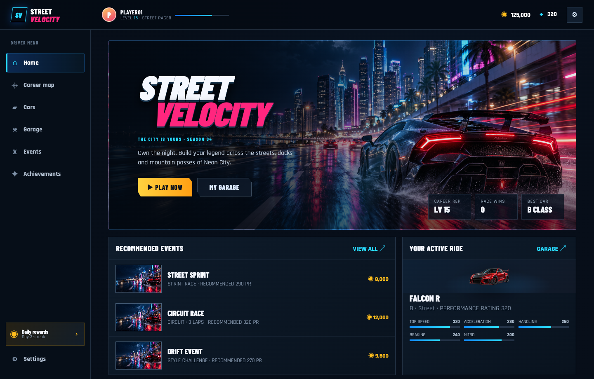
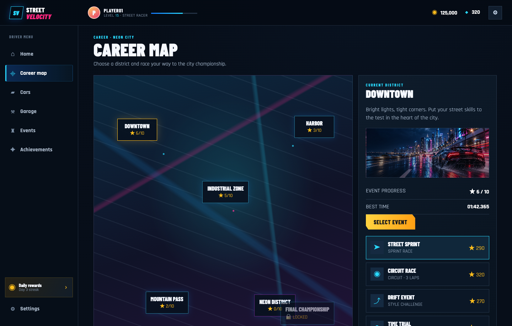
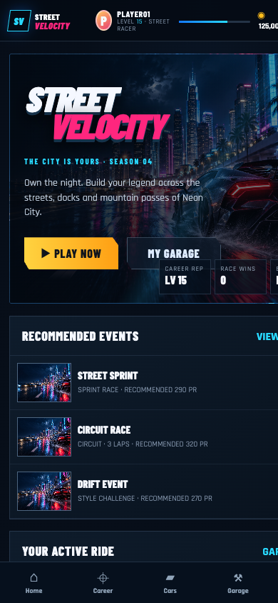

# Street Velocity — Web Racing Game

Street Velocity is a neon night racer with separate responsive web and landscape Android/iOS editions. Phases 1–4 include 22 reference-inspired screens, career and garage flows, mobile touch/wheel/tilt controls, five race events, rewards and local progression, eight purchasable performance parts per car, and prototype traffic, rivals, and police actors. The browser edition also has its own race rendering with drift scoring and time trial targets.

## New 3D prototype: Speed Velocity

The original `Web_Game/` remains the established arcade racer. A separate Three.js vertical slice in [`speed-velocity/`](speed-velocity/README.md) adds a walkable coastal city, a drivable car, checkpoints, map, and menus. Run it from the repository root with `python3 -m http.server 8001` and open [http://localhost:8001/speed-velocity/](http://localhost:8001/speed-velocity/).

## Screenshots

| Desktop game | Career map |
| --- | --- |
|  |  |

Phone layout:



The newer Speed Velocity web game also has updated desktop and phone-sized screenshots in [`speed-velocity/screenshots/`](speed-velocity/screenshots/).

## Run locally

```sh
python3 -m http.server 8000
```

Open [http://localhost:8000/](http://localhost:8000/) or [http://localhost:8000/Web_Game/](http://localhost:8000/Web_Game/).

## Controls

- Desktop: WASD or arrow keys to steer and accelerate, Down or Space to brake, Shift to drift, and N for nitro.
- Touch: on-screen steering, throttle, brake, drift, and nitro controls.

Progress is saved locally in the browser. See [`Web_Game/README.md`](Web_Game/README.md) for race flow and storage details. For Unity Android/iOS source, switch to the [`mobile` branch](https://github.com/haroondhanyal/Street-Velocity-Unity-Web-Mobile-Racing/tree/mobile).
